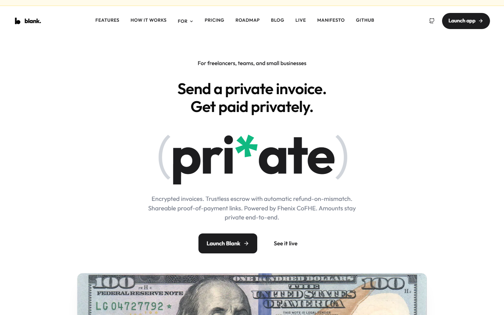

<div align="center">
  

# blank.

### Private amounts for public Ethereum payments.

Sender and receiver remain public. Payment amounts stay encrypted.

[](https://app.myblank.app)
[](https://www.fhenix.io/)
[](https://sepolia.basescan.org/)
[](https://sepolia.etherscan.io/)
[](https://sepolia.arbiscan.io/)
[](https://github.com/Pratiikpy/Blank/actions/workflows/ci.yml)

[Launch app](https://app.myblank.app) | [Demo video](https://youtu.be/lfzCa82kvtQ) | [Whitepaper](https://docs.myblank.app) | [Pitch deck](https://www.myblank.app/pitchdeck) | [Proof deck](https://www.myblank.app/proof-deck) | [Status](https://www.myblank.app/status) | [Brand kit](https://brand.myblank.app) | [Blog](https://blog.myblank.app/blog)

</div>

<p align="center">
  
</p>

## What Blank Is

Blank is confidential payment infrastructure for public blockchains. It is built for payments where public amounts expose commercially sensitive information: invoices, vendor payments, payroll, fundraising, commerce, and settlement.

Blank encrypts amounts in the browser and settles encrypted state through Fhenix CoFHE contracts on public testnets. It is not a mixer and does not conceal who transacted or that a transaction occurred.

### Privacy Boundary

| Public on-chain | Encrypted or permission-gated |
| --- | --- |
| Sender and recipient addresses | Payment amounts |
| Network, timing, contract calls, transaction hashes | Configured aggregate values and threshold checks |
| Public lifecycle transitions, such as created or settled | Decryption output where a permit is required |

## Product Surface

| Area | Available capabilities |
| --- | --- |
| Payments | Encrypted sends, payment requests, invoices, conditional invoices and batch payments |
| Shared money | Groups, gifts, claim links, inheritance planning |
| Commerce | Storefront purchases, crowdfund campaigns, encrypted escrow |
| Exchange | Token swaps, cross-chain bridge interface, P2P offramp flow (testnet only) |
| Identity and proofs | Payment handles, public payment pages, payment receipts, encrypted income and balance proofs |
| Account safety | Guardian recovery surfaces, privacy controls, activity history |

### Important Product Boundaries

- Conditional invoices (encrypted escrow that releases on payer approval or after a deadline, built on Reineira's open `IConditionResolver` settlement standard) are live on Arbitrum Sepolia only.
- Storefront records payment and purchase state. Digital-item delivery is seller-handled today.
- Offramp contracts and UI are available on testnet; the proof path uses the declared testnet verification setup until production provider and arbitration controls are activated.
- Scheduled-send authorization surfaces are present; automated execution is not yet a supported testnet capability.
- Testnet assets only. Blank is not available for mainnet value.

## Live Testnet

| Network | Chain ID | Application | Explorer |
| --- | ---: | --- | --- |
| Base Sepolia | `84532` | [Open app](https://app.myblank.app) | [BaseScan](https://sepolia.basescan.org/) |
| Ethereum Sepolia | `11155111` | [Open app](https://app.myblank.app) | [Etherscan](https://sepolia.etherscan.io/) |
| Arbitrum Sepolia | `421614` | [Open app](https://app.myblank.app) | [Arbiscan](https://sepolia.arbiscan.io/) |

Public surfaces:

| Resource | URL |
| --- | --- |
| Product site | [www.myblank.app](https://www.myblank.app) |
| Application | [app.myblank.app](https://app.myblank.app) |
| Technical paper | [docs.myblank.app](https://docs.myblank.app) |
| Brand system | [brand.myblank.app](https://brand.myblank.app) |
| Writing | [blog.myblank.app/blog](https://blog.myblank.app/blog) |
| Network status | [www.myblank.app/status](https://www.myblank.app/status) |

The current public testnet scope supports standard EVM wallets and passkey smart accounts across all three Sepolia networks. Gas for smart accounts is sponsored by a verifying paymaster on each chain: the backend signs a sponsorship only after confirming the sender is a Blank account.

Responsive screens are available. Full mobile transaction qualification remains separate from the desktop testnet scope.

## How Amount Privacy Works

1. The browser encrypts the payment amount before it reaches the contract call.
2. CoFHE validates encrypted input and makes ciphertext available for permitted contract computation.
3. Blank contracts update balances, totals and conditions while amounts remain ciphertext.
4. Authorized users request permitted decryption only where a product flow requires revealed output.

```text
User input
   |
   v
Client-side encrypted amount + proof
   |
   v
Blank contract on Sepolia <-> Fhenix CoFHE coprocessor
   |
   v
Encrypted state update on a public chain
```

## Architecture

| Layer | Responsibility | Primary code |
| --- | --- | --- |
| Web application | Wallet interaction, encrypted input, transaction UX, public pages | [`packages/app`](packages/app) |
| Smart contracts | Vaults, payments, commerce, proofs, recovery and exchange state | [`packages/contracts`](packages/contracts) |
| CoFHE integration | Encrypted inputs, ACL permissions and FHE operations | [`packages/contracts/contracts`](packages/contracts/contracts) |
| API and indexing | Health, metadata, events and operational endpoints | [`packages/app/api`](packages/app/api) |
| Product documentation | Architecture, threat boundaries and public specification | [`docs`](docs) |

Contract families include encrypted vaults and payments, business and creator workflows, commerce and escrow, exchange and offramp, handles and recovery, and privacy proofs.

For the public product documentation, start with the [docs index](docs/README.md).

## Testnet Deployments

The core contract set is deployed on all three supported testnets. The conditional-invoice resolver and the session-key validator are on Arbitrum Sepolia only. Every contract is owned by a 2-of-3 Safe multisig.

| Contract | Base Sepolia | Ethereum Sepolia | Arbitrum Sepolia |
| --- | --- | --- | --- |
| `FHERC20Vault_USDC` | [`0x789f...ff23`](https://sepolia.basescan.org/address/0x789f0bC466E172eD737493e9796a6d0a3aB0ff23) | [`0x3a58...AB51`](https://sepolia.etherscan.io/address/0x3a587f224CC3e1745565cfca8500e5934485AB51) | [`0x22c5...569E`](https://sepolia.arbiscan.io/address/0x22c543F1303Ba25A52694C89D8d09D26FBb7569E) |
| `TokenRegistry` | [`0x6889...Ec2E`](https://sepolia.basescan.org/address/0x68890C23C94e25706F064f8C1d07e04462B9Ec2E) | [`0xE233...888A`](https://sepolia.etherscan.io/address/0xE2333a6c58E21A8Cc45982612a31dB1440D9888A) | [`0x3032...F0D8`](https://sepolia.arbiscan.io/address/0x30329fAf6D44955D9Cd8074011D64174fF12F0D8) |
| `PaymentHub` | [`0xF420...e831`](https://sepolia.basescan.org/address/0xF420102Dea1acf437bfc49ded5F4E2f5ed32e831) | [`0xB628...b5eB`](https://sepolia.etherscan.io/address/0xB628719994C21A5CcAb190019b42750f092Fb5eB) | [`0x899f...d6C5`](https://sepolia.arbiscan.io/address/0x899f22B60A856Ec6FCb7C888c43f1A9891E9d6C5) |
| `BusinessHub` | [`0xEfD6...1EFD`](https://sepolia.basescan.org/address/0xEfD67E33f12a7b3A221d25f965f70d1BE6721EFD) | [`0x3048...5717`](https://sepolia.etherscan.io/address/0x3048Df6de18355EB6ce2eF0bB923B55E75FB5717) | [`0x79A5...53BF`](https://sepolia.arbiscan.io/address/0x79A544EfA82fc1567FfF008ACb8BD90FE6f853BF) |
| `ClaimLinks` | [`0x2eD7...4665`](https://sepolia.basescan.org/address/0x2eD78815299C2B1F2cBd2313CF763B56A0654665) | [`0x9E21...12Be`](https://sepolia.etherscan.io/address/0x9E2189149deec5e78cB2976d8DF64CAec40B12Be) | [`0xdf69...c015`](https://sepolia.arbiscan.io/address/0xdf69Ba30369C0881fF5741Ffbf26138c1413c015) |
| `Storefront` | [`0xeA8a...d419`](https://sepolia.basescan.org/address/0xeA8a38f25ECF9Cc8C9240aafb35b561D14Dfd419) | [`0x786C...695b`](https://sepolia.etherscan.io/address/0x786C85880e0FCF123D726600D9784ee88B84695b) | [`0x6548...d9c4`](https://sepolia.arbiscan.io/address/0x6548466E91547af9F6698a7AF236f9ef8548d9c4) |
| `EncryptedCrowdfund` | [`0x0F21...183C`](https://sepolia.basescan.org/address/0x0F21705575e2CC83dC410AE2af6973B150a4183C) | [`0x383B...24e1`](https://sepolia.etherscan.io/address/0x383B58973f7e8DC3E47D1C2f55393E2ac48b24e1) | [`0x4Fac...e359`](https://sepolia.arbiscan.io/address/0x4Face583A92f27b36f5098561CB731Aa1DbEe359) |
| `EncryptedEscrow` | [`0x6414...e421`](https://sepolia.basescan.org/address/0x6414742D2da28eCEf06D79b82F406B6b8ab3e421) | [`0x4253...0feC`](https://sepolia.etherscan.io/address/0x4253163CfCd0cf9885333E0a7B7476d61F010feC) | [`0xfDd7...db6d`](https://sepolia.arbiscan.io/address/0xfDd77d3b6489600466Da74f012bC7A7A342fdb6d) |
| `P2POfframp` | [`0xd717...32f9`](https://sepolia.basescan.org/address/0xd717E7AFE5eB627c9913bc682003d6E83b9032f9) | [`0x5981...444a`](https://sepolia.etherscan.io/address/0x5981C437032Da38844AE9a3aa382F993b1B8444a) | [`0x653e...961f`](https://sepolia.arbiscan.io/address/0x653e71e5F02a0fEAAFfCab5391DF0AE99b89961f) |
| `GuardianModule` | [`0x4fa2...5B46`](https://sepolia.basescan.org/address/0x4fa2152A940651404F2722c0192624d0662e5B46) | [`0xdBE8...0c3E`](https://sepolia.etherscan.io/address/0xdBE8252D1e089759b56E742843303f0b18700c3E) | [`0x4e9d...C37A`](https://sepolia.arbiscan.io/address/0x4e9d93739b6F3543017C46d844F2021B6f5dC37A) |
| `BlankPaymaster` | [`0x0096...430A`](https://sepolia.basescan.org/address/0x009645a8Fe34796e2e18534441E906899c5F430A) | [`0x691a...Bf13`](https://sepolia.etherscan.io/address/0x691aae146A71A45A633d8b023A1c1B41f34dBf13) | [`0xdfc2...28a8`](https://sepolia.arbiscan.io/address/0xdfc2606B1Ba148CC35b93849ac888BD7DfFD28a8) |
| `InvoiceApprovalResolver` | not deployed | not deployed | [`0xc68C...E78b`](https://sepolia.arbiscan.io/address/0xc68C56a8Ad23E515eD56F2B98FC93341D98cE78b) |
| `SessionKeyValidator` | not deployed | not deployed | [`0xd679...7668`](https://sepolia.arbiscan.io/address/0xd679978e0334f0e8D4799d2E51755fEE8EE77668) |
| Owner (2-of-3 Safe) | [`0x38e4...8D72`](https://sepolia.basescan.org/address/0x38e43E5255c86d5B2e93e6E0708406Ff03908D72) | [`0x38e4...8D72`](https://sepolia.etherscan.io/address/0x38e43E5255c86d5B2e93e6E0708406Ff03908D72) | [`0x38e4...8D72`](https://sepolia.arbiscan.io/address/0x38e43E5255c86d5B2e93e6E0708406Ff03908D72) |

The encrypted-vault FHE path is proven on Arbitrum Sepolia by a real shield transaction: [`0xc623...9585`](https://sepolia.arbiscan.io/tx/0xc623277ed8a44895b149d7b29e8854da5a967e131f463c91e4dca5bb3aa09585). The feature set has since been driven through the UI on Arbitrum Sepolia with a real browser wallet, including multi-wallet send and consume flows, each with an on-chain transaction.

All three testnets run `cofhe-contracts` 1.0.0 and `@cofhe/sdk` 0.8.0. The move was an in-place upgrade of 19 proxies per chain: no address changed and all state was kept. Two-wallet browser runs on 1.0.0, judged from chain state, passed on all three networks: gift claim, invoice pay, group, request pay, claim link and stealth claim. Each chain's upgrade was also proven by a live shield and unshield.

On 17 October 2026 a security upgrade shipped to all three testnets after an internal review of every contract and a second independent pass on the fixes. Each hub now accepts only vaults listed in `TokenRegistry`, settles on the amount a vault actually moved, and limits who can read encrypted values. Disputes time out instead of locking funds. Proxies were upgraded in place with state kept, and ownership moved to the Safe. Two-wallet browser runs on www.myblank.app passed on all three networks afterwards: receive, invoice to paid, claim link, group settle, request to fulfilled and stealth claim. The standalone proof-of-balance contract and the token P2P exchange are retired: their old records stay readable, new entries are closed.

Complete machine-readable deployment manifests:

- [Base Sepolia deployment](packages/contracts/deployments/base-sepolia.json)
- [Ethereum Sepolia deployment](packages/contracts/deployments/eth-sepolia.json)
- [Arbitrum Sepolia deployment](packages/contracts/deployments/arb-sepolia.json)

## Repository

```text
blank/
|-- packages/
|   |-- app/                 React application, API routes and live QA flows
|   `-- contracts/           Solidity contracts, deployments and tests
|-- docs/                    Product documentation and launch scope
`-- README.md
```

## Develop Locally

Requirements:

- Node.js 20+
- pnpm 10+
- A browser wallet for interactive testnet use

```bash
git clone https://github.com/Pratiikpy/blank.git
cd blank
pnpm install --frozen-lockfile

cd packages/app
pnpm dev
```

Create local environment configuration only for flows that require RPC, indexing or operational integrations:

```bash
cd packages/app
cp .env.example .env
```

On Windows PowerShell:

```powershell
Copy-Item .env.example .env
```

## Validation

Application:

```bash
cd packages/app
pnpm run ci
pnpm exec vitest run
pnpm check:voice:strict
```

Contracts:

```bash
cd packages/contracts
pnpm exec hardhat compile
pnpm exec hardhat test
pnpm storage:check
```

Operational testnet verification scripts are maintained with the application in [`packages/app/e2e`](packages/app/e2e). Public health is visible at [www.myblank.app/status](https://www.myblank.app/status).

## Security And Release Boundary

- Blank protects amount confidentiality, not participant identity or transaction existence.
- Ciphertext permissions and decryption rely on the CoFHE access model and its network assumptions.
- Upgradeable contracts are guarded by storage layout checks in development and CI.
- Upgrades and admin functions require 2 of 3 Safe signers. There is no timelock.
- The storefront does not yet provide automatic digital file fulfillment.
- The offramp is a testnet product surface; production-grade provider verification, dispute operations and governance controls remain release gates.
- Mainnet use is not supported before an external audit, Fhenix production readiness, finalized operations and key-management controls.

Security issues should be reported according to [SECURITY.md](SECURITY.md).

## Read More

| Document | Purpose |
| --- | --- |
| [Demo video](https://youtu.be/lfzCa82kvtQ) | Two-minute product walkthrough |
| [Whitepaper](https://docs.myblank.app) | Privacy model, architecture and security boundary |
| [Pitch deck](https://www.myblank.app/pitchdeck) | Product story, market framing and founder context |
| [Proof deck](https://www.myblank.app/proof-deck) | Public testnet evidence and supporting material |
| [Brand kit](https://brand.myblank.app) | Identity system and public assets |
| [Blog](https://blog.myblank.app/blog) | Technical and product writing |
| [Docs index](docs/README.md) | Public repository documentation |
| [Launch readiness](docs/LAUNCH_READINESS.md) | Testnet scope and release boundaries |

## Contributing

Please read [CONTRIBUTING.md](CONTRIBUTING.md) before opening a pull request.
Security reports must go through private channels described in [SECURITY.md](SECURITY.md), not public issues.
Behavior expectations are documented in [CODE_OF_CONDUCT.md](CODE_OF_CONDUCT.md).

## License

MIT. Built with [Fhenix CoFHE](https://www.fhenix.io/).
